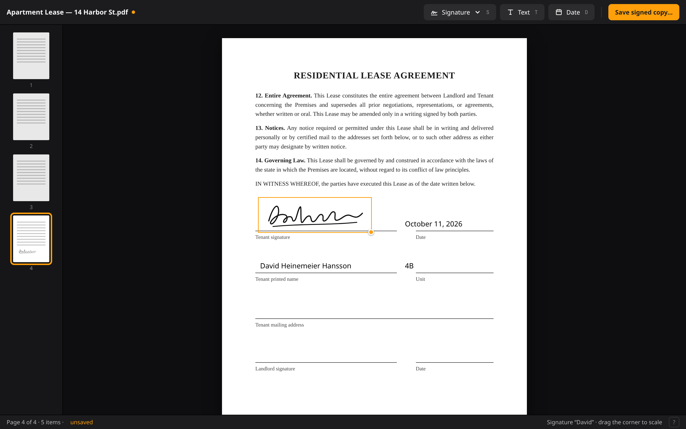

# Signature

Sign and fill in PDFs. Open a PDF, drop your signature, a line of text, or today's date anywhere on a page, move and size it, and save a signed copy. Modeled on the markup tools in Apple's Preview, cut down to just the signing part.

It's an Omarchy app built like Omacut and Hype: C++ and Qt Quick, qmake6 into a single binary, Material dark, following the theme accent, installed as an Arch package.

Layout mockups (direction, not pixel spec): [empty](renderings/signature-1-empty.png), [signed page](renderings/signature-2-main.png), [signature menu](renderings/signature-3-menu.png), [add signature](renderings/signature-4-add.png), [editing text](renderings/signature-5-text.png), [hotkeys](renderings/signature-6-keys.png). Source: [mockups.html](renderings/mockups.html).



## The one job

1. Open a PDF (Ctrl+O, a file argument, or drop it on the window).
2. Place things on its pages:
   - **Signature** — a saved signature image, picked by name.
   - **Text** — a line of text you type in place.
   - **Date** — today's date as text, editable like any text.
3. Drag them around, drag a corner to scale, Delete to remove.
4. Save a signed copy (Ctrl+S). The original is never touched.

That's all. No annotations, highlights, shapes, form-field detection, page editing, or drawing.

## Layout

```text
┌──────────────────────────────────────────────────────────────────┐
│ lease.pdf            [✍ Signature ▾] [T Text] [📅 Date]   [Save] │
├───────┬──────────────────────────────────────────────────────────┤
│ ┌───┐ │                                                          │
│ │ 1 │ │              ┌────────────────────────────┐              │
│ └───┘ │              │                            │              │
│ ┌───┐ │              │   page 2, scrolled view    │              │
│ │ 2 │ │              │                            │              │
│ └───┘ │              │      ┌──────────────┐      │              │
│ ┌───┐ │              │      │ ~ D.H.H. ~   │◢     │              │
│ │ 3 │ │              │      └──────────────┘      │              │
│ └───┘ │              │   Date: 10/11/2026         │              │
│       │              └────────────────────────────┘              │
├───────┴──────────────────────────────────────────────────────────┤
│ Page 2 of 3 · 2 items · unsaved                              ?  │
└──────────────────────────────────────────────────────────────────┘
```

- **Top bar**: file name, the three insert buttons, Save.
- **Left strip**: page thumbnails; click to jump. Hidden for one-page PDFs.
- **Center**: pages in a vertical scrolling column on the dark window, zoomed to fit width by default (Ctrl+= / Ctrl+- / Ctrl+0).
- **Status line**: page, item count, saved state, `?` for hotkeys — the same as Omacut.
- **Empty state**: "Open a PDF to sign" with a button, and the hint that you can drop one.

### Signature menu

The Signature button opens a popup listing saved signatures by name, each with its image. Click one to place it. At the bottom: **Add signature…** and, on hover over a row, × to delete it.

**Add signature…** opens a small dialog:

- Choose an image (PNG/JPEG via the portal file picker).
- Preview with the background removed: each pixel's alpha comes from its darkness relative to the paper (a soft ramp, not a hard cut, so edges don't fringe), ink is recolored to pure black-ish keeping its hue, and the result is cropped to the ink's bounds. A **Threshold** slider moves the ramp. EXIF orientation is applied on load. PNGs that already have transparency are kept as-is (only cropped). An image that ends up empty is an error, not a blank signature.
- The promise is "a scan or a well-lit photo on white paper"; the dialog says so. No crop/rotate tools, no lighting correction in v1.
- A **Name** field ("David", "Initials").
- Save.

Signatures are stored as `~/.local/share/signature/signatures/<name>.png` (respecting `$XDG_DATA_HOME`), written atomically. The file name is the name; no database, no index. Names that are empty, start with a dot, or contain `/` are rejected; an existing name asks to replace.

Placed signatures keep their own copy of the image in the session, so deleting or replacing a signature in the library never breaks items already on the page or in undo history.

First run: the Signature menu is empty and says "Add an image of your signature — a scan or a photo of it on white paper." 

## Placing and editing items

- Inserting places the item in the center of the visible part of the **current page** (the page covering the middle of the viewport), selected. A signature uses the size it was last placed at (remembered per signature), else ~1.5 in wide; text starts at the last-used size, else 12 pt.
- **Click** selects; the selection shows an accent outline and a corner handle at the bottom-right.
- **Drag** moves; items are clamped to stay on their page. Dragging between pages is not supported; delete and re-add.
- **Drag the corner** scales, keeping aspect ratio. For text, scaling changes the font size.
- **Double-click text** (or Enter on a selected text item) to edit it inline. Text can be multiple lines (Shift+Enter for a new line; Enter or Escape or clicking elsewhere ends editing), for things like addresses. No wrapping: lines are as wide as they are. Empty text is removed when editing ends.
- **Date** inserts today's date formatted with the system locale's short date format (`QLocale::system()`), as an ordinary text item.
- Arrow keys nudge the selected item 1 pt (Shift: 10 pt). Delete/Backspace removes it. Ctrl+D duplicates.
- Text is black, in **Noto Sans** (always present on Omarchy via `noto-fonts`; Qt subsets and embeds it in the PDF). No font picker, no colors. While text is selected, the status line shows its size in points; `[` / `]` step it.
- One text-layout contract: a text item's box is **derived** from its text and font size (`QFontMetricsF` at 72 DPI, in points), never stored independently. Both the QML view and the export lay out text through the same C++ function, so preview and PDF match. QML renders text at `fontSize × scale` pixels, not QML point sizes (which depend on display DPI).
- Form fields in the PDF (AcroForm widgets) are rendered as part of the page but not editable. Since the overlay is page content, a filled form widget could paint over a placed item; we note it and don't fight it in v1.

## Saving

Ctrl+S opens the save portal suggesting `<name>-signed.pdf` beside the original. Never overwrite the source file: compare canonical paths (`QFileInfo::canonicalFilePath`, catches symlinks) and refuse with a message.

Saving exports an immutable snapshot of the items. Items stay on screen and editable afterwards; saving again re-stamps the **original** PDF, never the previously signed output. Dirty state clears only if nothing changed since the snapshot was taken.

How the PDF is written, keeping the original pages as vector:

1. **Overlay with QPdfWriter.** One page per source page, each exactly the page's *displayed* size in points (rotation-adjusted CropBox, which is what poppler's `pageSizeF()` already returns — don't rotate it again). `setResolution(72)` so painter units are points, zero margins, set the page size *before* each `newPage()`, no background painted. Signatures are drawn with `QPainter::LosslessImageRendering` so they go in as lossless images with their alpha; text is drawn as real vector text.
2. **Stamp with libqpdf** (C++ library, not the CLI). The `qpdf --overlay` CLI fits overlays into the destination's TrimBox, which shifts items on PDFs whose TrimBox ≠ CropBox. Instead, for each page: import the overlay page as a form XObject (`QPDFPageObjectHelper::getFormXObjectForPage`) and append it to the page's content with an explicit matrix we compute: map `[0,0,w,h]` of the overlay onto the source page's CropBox, undoing its inherited `/Rotate` (0/90/180/270) and honoring a non-zero box origin and `/UserUnit`. Existing content is wrapped in `q … Q` first (`addPageContents` + `shallowCopyPage` pattern) so a page that leaves the graphics state dirty can't skew the overlay. Pages without items are skipped.
3. **Write** with `QPDFWriter` to a unique sibling temp file (`QSaveFile`-style: `<out>.XXXXXX`), then rename into place. Any failure leaves an existing output untouched and reports the error in the window. qpdf warnings (damaged-but-recovered input) are surfaced in the status line, not treated as failure.

Text stays selectable, the original content is unchanged, signatures stay sharp.

Not supported in v1: encrypted/password-protected PDFs (shown as an error on open), editing a previously signed PDF's items (once saved, they're flattened into the page — that's the point).

## Rendering

Pages are rendered with **poppler-qt6** through a `QQuickAsyncImageProvider` (like Omacut's thumbnail provider): `image://pages/<generation>/<page>/<pixelWidth>`. The generation increments on every open, so a new document never shows a stale page.

- One render worker thread owns its own `Poppler::Document`; it's never shared across threads and is torn down only after pending requests finish or are cancelled.
- The page column is a `ListView` (virtualized), so only visible pages plus one on either side are requested. Render width is the displayed width × device pixel ratio, capped (e.g. 4000 px), re-requested after a zoom settles. A small byte-capped cache keeps recent renders.
- Thumbnails use the same provider at a small width.

Poppler gives page size in points (CropBox, already rotation-adjusted), which is the coordinate space for everything else. (QtPdf would also work but drags in qt6-webengine; poppler-qt6 is small.)

## Model

All coordinates are in **PDF points, relative to the page's top-left as displayed** (after /Rotate). QML converts with a single `scale = displayedWidth / pageWidthPt`.

```cpp
struct Item {
    enum Kind { Signature, Text };   // Date is Text with a date in it
    Kind kind;
    int page;
    QRectF rect;          // points
    QString text;         // Text
    QImage image;         // Signature: own copy, independent of the library
    qreal fontSize;       // Text, points; Text rect size is derived from it
};
```

## Code shape

```text
signature.pro
bin/build  bin/test  bin/install
src/main.cpp
src/backend.{h,cpp}          open/save, current file, dirty flag, undo stack, errors
src/document.{h,cpp}         poppler wrapper: page count, page sizes
src/textlayout.{h,cpp}       the one text measure/paint function, shared by view and export
src/pageprovider.{h,cpp}     QQuickImageProvider for pages + thumbnails
src/items.{h,cpp}            QAbstractListModel of placed items (role per field)
src/signatures.{h,cpp}       QAbstractListModel over the signatures dir; add (with bg removal) / delete
src/stamper.{h,cpp}          overlay with QPdfWriter, stamped with libqpdf
src/filepicker.h  src/portalfilepicker.{h,cpp}   copied from Omacut, with attribution
src/theme.{h,cpp}            accent follower (template)
src/Main.qml                 window, top bar, status line, shortcuts, overlays
src/PageView.qml             one page image + its items
src/PlacedItem.qml             a placed item: move, scale handle, inline text editing
src/SignatureMenu.qml        popup list + add dialog
src/resources.qrc
tests/signature_tests.{pro,cpp}
pkgbuild/PKGBUILD  signature.desktop  signature.svg  signature.install
```

Roughly Omacut-sized (~2–3k lines).

Undo/redo: snapshot the item list on each discrete change (insert, delete, end of drag, end of text edit). Item lists are tiny; snapshots beat a command pattern.

## Hotkeys

| Key | Action |
| --- | --- |
| Ctrl+O | Open a PDF |
| Ctrl+S | Save a signed copy |
| S | Place the last-used signature (opens the menu if none) |
| Shift+S | Open the signature menu |
| T | Place text (and start editing) |
| D | Place today's date |
| Enter | Edit the selected text |
| Arrows / Shift+Arrows | Nudge selected item 1 / 10 pt |
| Ctrl+D | Duplicate selected item |
| [ / ] | Smaller / larger (text size, or signature scale) |
| Delete, Backspace | Remove selected item |
| Escape | Deselect / stop editing |
| Page Up / Page Down | Previous / next page |
| Ctrl+= / Ctrl+- / Ctrl+0 | Zoom in / out / fit width |
| Ctrl+Z / Ctrl+Shift+Z | Undo / redo |
| Q | Quit (asks first if there are unsaved items) |
| ? | Show hotkeys |

Single-letter keys, Delete, arrows, Ctrl+D, and document undo/redo are all inactive while any text field has focus (inline text, the signature name field). Q, window close, Open, and dropping a new PDF all ask first when there are unsaved items.

## Tests

Offscreen Qt Test, compiling `../src/*.cpp` in, using temp dirs:

- Background removal: white → transparent, soft edges, ink kept, crop to bounds; transparent PNG kept; blank image rejected; EXIF rotation applied.
- Signatures dir: add, list sorted by name, delete, replace, bad names rejected; placed item survives library deletion.
- Item model: insert, move clamped to page, scale keeps aspect, text box derived from text, undo/redo.
- **Stamping geometry** — the riskiest part, so it's built and tested first, before any UI. Checked-in fixture PDFs (built once with qpdf from a QPdfWriter page by editing the page dictionaries) covering: /Rotate 0/90/180/270 (including inherited from the Pages node), CropBox ≠ MediaBox, a CropBox with a non-zero/negative origin, TrimBox ≠ CropBox, mixed page sizes, a page whose content leaves an unbalanced `cm`. For each: stamp an asymmetric marker (a filled square at the top-left, a smaller one at the bottom-right) and a semi-transparent signature over existing text, render the result with poppler, and check the markers' pixel positions and that pixels outside them are unchanged from the original render. Plus a `textList()` check that stamped text is real text at the right spot, including accented names.
- Saving: refuse the source (and a symlink to it); a failing save leaves an existing output untouched; saving twice stamps the original, not the previous output.

## Dependencies

Runtime: `qt6-base qt6-declarative poppler-qt6 qpdf noto-fonts xdg-desktop-portal`. Build: the same plus `gcc make`. Linking libqpdf and poppler-qt6 directly (both small, both already pulled in on most Omarchy installs) is simpler and more exact than shelling out.

## Build order

1. Stamper + geometry fixtures + tests (no UI).
2. Document + async page provider, scrolling page column.
3. Item model, PlacedItem (move/scale/edit), text layout, undo.
4. Signature library + add dialog.
5. Save flow, guards, hotkeys overlay, empty state, packaging.

## Open questions

- Should "Add signature" also allow drawing with the mouse/trackpad? Apple captures from trackpad, camera, or phone; importing an image is the extra step it skips. Proposed: no for v1, images only, as asked — revisit after using it.
- Date format: system locale short format vs. a fixed ISO date. Proposed: locale, editable afterwards anyway.

## Review notes

Reviewed with Codex. Adopted: libqpdf with an explicit placement matrix instead of `qpdf --overlay` (TrimBox fitting), geometry-first fixture tests, explicit QPdfWriter units/lossless alpha, async virtualized rendering with generation keys, save snapshots and discard guards, a single text-layout path with a named font, session-owned signature images, soft-alpha background removal with a scoped promise, multi-line text and a size control, and input suppression while editing. Declined for v1: crop/rotate/lighting tools for signature photos, drawing signatures.
